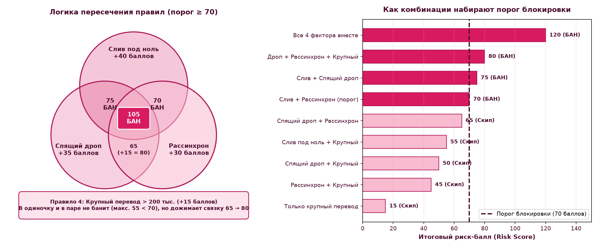
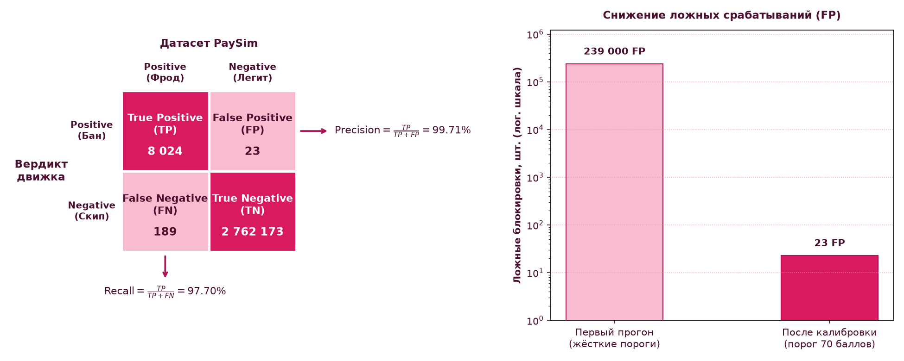

# Скоринговый антифрод-движок на Python (детекция захвата аккаунтов и спящих дропов)

Прототип транзакционного антифрод-движка первого эшелона (L1), который отлавливает угон аккаунтов, балансовые аномалии и вывод денег через подготовленные дроп-счета. Проект собран и протестирован на 2,77 млн банковских операций из датасета **PaySim**.

---

## Зачем это нужно и какие проблемы решает

В банковском и финтех-антифроде при настройке правил постоянно приходится балансировать между тремя вещами:

1. **Сильный дисбаланс классов.** Реального мошенничества в общем потоке меньше `0,3%`. Если сделать правила слишком жёсткими, система начнёт массово тормозить переводы обычных людей, перегружая поддержку и вызывая отток клиентов.
2. **Ловушка «строгого нуля».** Простые фильтры ищут карты дропов с балансом ровно `0.00`. На практике мошенники заранее прогревают счета: дают им отлежаться 20–30 дней и держат на них «пылевой» остаток (несколько сотен или пару тысяч у.е.), чтобы не светиться как свежий пустой кошелёк.
3. **Понятность решений (включая логику 161-ФЗ).** Банку важно уметь объяснить и клиенту, и регулятору, почему конкретный перевод ушёл на 48-часовой холд или блокировку. Взвешенные правила показывают прозрачную картину, в отличие от закрытого «чёрного ящика».

**Задача проекта:** собрать быстрый скоринговый пайплайн на правилах, который вылавливает >95% атак с минимальным числом ложных блокировок (*фолс-позитивов*).

---

## Как устроены правила и начисление баллов

Каждая операция проходит через 4 независимые проверки и набирает риск-баллы. Порог срабатывания защиты — **70 баллов**: ни один признак не блокирует клиента в одиночку, для приостановки операции должны совпасть минимум два тревожных сигнала.

* **Правило 1 — Слив баланса под ноль (`+40 баллов`):** со счёта отправителя одним платежом списывается весь остаток до копейки (`amount == oldbalanceOrg`) при положительном балансе до операции. Типичный почерк угона аккаунта.
* **Правило 2 — Спящий дроп или быстрый обнал (`+35 баллов`):**
  * *Для переводов (`TRANSFER`):* счёт получателя либо встречается впервые в истории, либо «спал» больше `500` часов (~21 день), а перед входящим переводом на нём лежал пылевой остаток `<= 2 500` у.е. Реализовано через группировку по получателю и оконный сдвиг `.shift(1)` после сортировки по времени — без подглядывания в будущее (*дата-ликиджа*).
  * *Для снятия наличных (`CASH_OUT`):* вывод денег в кэш сразу после полного обнуления баланса.
* **Правило 3 — Балансовый рассинхрон (`+30 баллов`):** проверка бухгалтерского равенства проводки `(oldbalanceOrg - amount) - newbalanceOrig != 0` с фильтрацией штатных овердрафтов при снятии наличных.
* **Правило 4 — Крупная сумма (`+15 баллов`):** внешний перевод свыше `200 000` у.е. Работает как усилитель, если уже сработал один из основных маркеров.



---

## Результаты проверки на датасете PaySim

Из полного массива PaySim (6,3 млн строк) для теста отобраны **2 770 409** целевых операций — внешние переводы (`TRANSFER`) и снятие наличных (`CASH_OUT`), где технически реализуется вывод украденных средств (из них `8 213` — размеченный фрод).

| Метрика | Значение | Что это значит на практике |
| :--- | :--- | :--- |
| **Реколл (Recall)** | **97.70%** | Поймано `8 024` из `8 213` реальных атак вывода средств |
| **Пресижн (Precision)** | **99.71%** | `99.7%` всех срабатываний — реальный фрод, а не ошибка |
| **Фолс-позитивы (FP)** | **23 операции** | Всего 23 ложных срабатывания на 2,77 млн переводов (`FPR ≈ 0.0008%`) |
| **Фолс-негативы (FN)** | **189 операций** | Пропущенные атаки изолированы в нестандартных сценариях |



---

## Калибровка правил и пост-мортем ошибок

На самом первом тестовом прогоне движок выдал около **239 000 фолс-позитивов** при **реколле ~51,5%**. Разбор логов показал две причины:
1. При снятии наличных (`CASH_OUT`) в базе часто встречается кредитный лимит / овердрафт, из-за чего балансовая формула давала ложный рассинхрон на честных операциях.
2. Значительная часть реальных атак проводилась на небольшие суммы, которые отсекались жёстким порогом в `70 000` у.е. внутри правила спящего дропа.

После разделения логики для `TRANSFER` и `CASH_OUT` и перебалансировки весов число ложных срабатываний упало с `239 000` до `23`, а *реколл* вырос до `97.70%`.

### Разбор оставшихся 189 пропусков (FN):
* **41 операция** — артефакт самого симулятора PaySim, где у скомпрометированного счёта изначально стоял нулевой баланс (`oldbalanceOrg == 0.0`).
* **148 операций** — дробление кражи на мелкие суммы внутри обычных лимитов без обнуления счёта.

**Вывод:** пытаться дожать эти `2,3%` за счёт снижения порогов по сумме нельзя — это снова взорвёт *фолс-позитивы* и заблокирует обычных клиентов. В боевом контуре такие кейсы закрываются вторым эшелоном (L2): графом связей между получателями и проверкой цифрового отпечатка устройства и сессии.

---

## Технические особенности реализации

* **Векторизация без циклов:** расчёт весов и итогового скора написан на `NumPy` (`np.where`) и `Pandas`, благодаря чему весь массив в 2,77 млн строк прогоняется за пару секунд.
* **Защита от утечки данных:** перед расчётом времени отлёжки таблица жёстко сортируется по `nameDest` и `step`, чтобы оконный сдвиг `.shift(1)` опирался только на прошлую историю клиента.
* **Не забудьте скачать сам датасет https://www.kaggle.com/datasets/mtalaltariq/paysim-data**


---

## Как запустить локально

1. Клонировать репозиторий и поставить библиотеки:
```bash
git clone [https://github.com/sereba-killer/antifraud-scoring-engine.git](https://github.com/sereba-killer/antifraud-scoring-engine.git)
cd antifraud-scoring-engine
pip install -r requirements.txt
