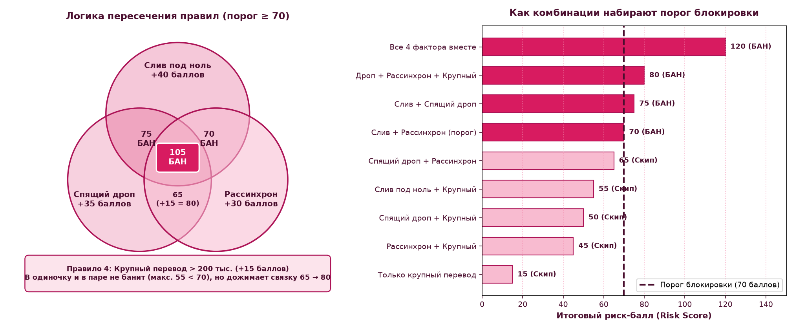
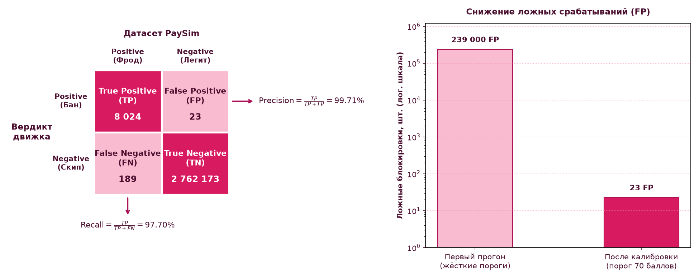

# Antifraud Scoring Engine (PaySim)

Пет-проект скорингового антифрод-движка на Python (`pandas` + `numpy`). Основная идея — собрать прозрачную систему правил для транзакционного мониторинга, которая ловит сливы баланса и вывод денег через дропов, но при этом не режет нормальные платежи.

## Зачем и как это устроено

В банковском антифроде, особенно если речь про малый бизнес, нельзя просто банить всё подряд:
* Любое ложное срабатывание  — это заблокированный платёж поставщику, сорванная зарплата или налоги, после чего клиент просто уходит в другой банк.
* Простые проверки вроде «у получателя до перевода был строгий ноль на счёте» на практике работают плохо — дроповоды заранее прогревают карты и оставляют на них небольшой остаток.
* По 161-ФЗ банку нужно чётко понимать и уметь объяснить, по какой именно причине операция попала под приостановку.

Поэтому вместо ящика пандоры на ML здесь сделан комбинаторный скоринг. Ни один признак не отправляет операцию в бан в одиночку, критический порог в **70 баллов** набирается только когда совпадают минимум два независимых фактора.

## Логика правил

Скрипт отбирает из датасета операции типов `TRANSFER` и `CASH_OUT`, именно через них возможен вывод средств, и проверяет четыре признака:

1. **Слив баланса под ноль +40 баллов** — сумма списания в точности равна остатку на счёте до операции `amount == oldbalanceOrg` при положительном балансе. Типичный сценарий при угоне аккаунта, когда деньги выгребают подчистую.
2. **Подозрительный канал вывода +35 баллов** — для переводов проверяется, что счёт получателя до этого охлаждался больше 500 часов (примерно 21 день) или вообще впервые встречается в истории, а на балансе у него лежали гроши до 2 500 единиц. Считается через оконный сдвиг `.shift(1)`, аналог SQL `LAG`. Для снятия наличных ловится попытка обналичить деньги сразу после обнуления счёта отправителя.
3. **Бухгалтерский рассинхрон +30 баллов** — проверка математического равенства `(oldbalanceOrg - amount) - newbalanceOrig == 0`. Если денег на счёте хватало, но остаток после проводки не сошёлся с арифметикой, операция помечается как аномальная с фильтрацией легитимного овердрафта, чтобы не собирать лишний шум.
4. **Крупный перевод +15 баллов** — сумма операции больше 200 000 единиц

Если транзакция набирает **70 баллов и выше**, система ставит флаг блокировки.



## Результаты прогона на PaySim

Пайплайн проверен на всём объёме целевых операций датасета PaySim — это **2,77 млн транзакций** (`TRANSFER` и `CASH_OUT`), среди которых 8 213 реальных мошеннических атак:

| Метрика | Результат | Пояснение |
| :--- | :---: | :--- |
| **Поймано фрода (TP)** | **8 024** | Успешно заблокированные атаки |
| **Ложные баны (FP)** | **23** | Ошибочно заблокированные честные операции (`FPR ≈ 0.0008%`) |
| **Пропущено атак (FN)** | **189** | Атаки, которые не добрали до порога 70 баллов |
| **Recall (Полнота)** | **97.70%** | Доля пойманных атак от всех реальных случаев фрода |
| **Precision (Точность)** | **99.71%** | Доля реального фрода среди всех срабатываний движка |



## Разбор ошибок или же Post-Mortem

После прогона я отдельно разобрал оставшиеся **189 пропусков (2.30%)**:
* **41 операция** имела нулевой начальный баланс отправителя `oldbalanceOrg == 0.0` — это особенность генерации самого синтетического датасета PaySim.
* **148 операций** проводились дроблением на небольшие суммы без полного обнуления счёта.

На первом прогоне попытка поймать эти 2,3% за счёт снижения порогов по суммам дала больше **239 000 ложных блокировок**. Отсюда главный вывод: дожимать такой остаток простыми правилами нельзя, а в реальном банке для этого подключают второй эшелон проверки: телеметрию устройства, поведенческую биометрию сессии и граф связей между счетами, а не закручивают гайки на первом слое.

## Стек и запуск

* **Python 3.10+**
* **Pandas** — фильтрация, группировки и оконный сдвиг `.shift()`
* **NumPy** — векторизованный расчёт скора через `np.where`
* **Не забудьте скачать и вставить сам датасет https://www.kaggle.com/datasets/mtalaltariq/paysim-data**

Чтобы запустить у себя:
1. Клонировать репозиторий и поставить зависимости:
```bash
git clone https://github.com/sereba-killer/antifraud-scoring-engine.git
cd antifraud-scoring-engine
pip install -r requirements.txt
